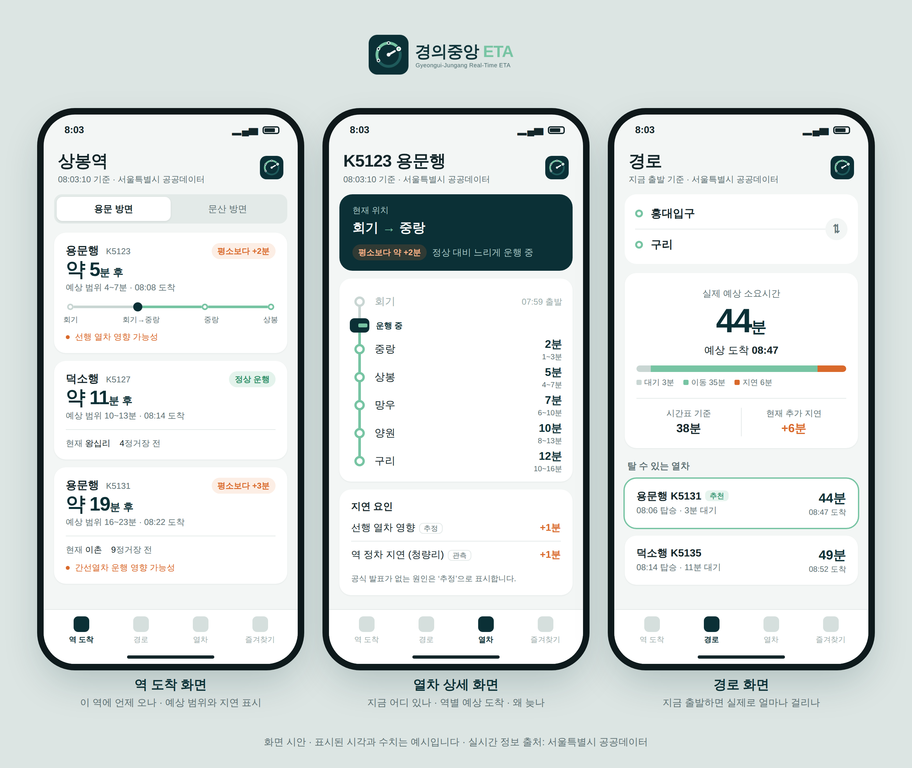

<p align="center">
  <picture>
    <source media="(prefers-color-scheme: dark)" srcset="docs/assets/logo-dark.png">
    
  </picture>
</p>

# Gyeongui-Jungang Real-Time ETA Predictor

경의중앙선 실시간 열차 위치를 수집해서 **역별 도착 ETA** 와 **A→B 실제 소요시간**을 예측하는 프로젝트입니다.

- 전체 기획: [`docs/PROJECT_SPEC.md`](docs/PROJECT_SPEC.md) (v0.2, 검토 의견 반영)
- Phase 1 설계 (데이터 소스 등급, DB, 수집기, 추적 엔진, Baseline ETA): [`docs/DESIGN.md`](docs/DESIGN.md)
- DB schema: [`db/schema.sql`](db/schema.sql)

## 화면 시안



역 도착 / 열차 상세 / 경로 화면 시안입니다. 수치는 예시이고, 원본은 [`docs/mockups/screens.html`](docs/mockups/screens.html) 입니다.

## 현재 상태 (Phase 1 / M1~M2 코어)

| 구성 | 상태 |
|---|---|
| 서울시 실시간 위치 API client + 방어적 파서 (raw 보존) | ✅ 구현, 엔드포인트 연결 확인 / **실제 열차 레코드로는 아직 미검증** |
| 수집기 (15초 폴링, 수집 시간대 지정, 1,000회/일 한도 관리, JSONL 저장, retry) | ✅ 구현 |
| 열차 추적: 진행 서수 모델로 진입/도착/출발 이벤트 생성 (시간 구간 + inferred 표시) | ✅ 구현 + 테스트 |
| 구간 주행시간 / 역 정차시간 파생 | ✅ 구현 + 테스트 |
| 시간대 버킷 통계 + fallback (L0/L1/L2) | ✅ 구현 + 테스트 |
| Baseline ETA (조건부 잔여시간, p20~p80 범위, confidence) | ✅ 구현 + 테스트 |
| 누수 없는 backtest + horizon 별 평가 | ✅ 구현 + 테스트 |
| PostgreSQL 적재기 | ⏳ TODO (schema 만 있음) |
| KTX/ITX 간섭, 지연 전파, A→B, 프론트엔드, ML | ⏳ 이후 Phase |

## 사용법

```bash
pip install -e ".[dev]"
python -m pytest

# 1) 실제 응답 schema 확인 (운행 시간대 05:00~01:00 KST 에 실행)
export SEOUL_API_KEY=발급받은_실시간_지하철_인증키
python scripts/probe_api.py --count 8 --interval 15

# 2) 수집 시작 (data/raw/YYYY-MM-DD.jsonl 에 쌓임)
#    한도 1,000회/일 → 출근 시간 4시간 × 15초 = 960회
python -m gjeta.collector --window 06:30-10:30

# 2-1) 자동 수집 (GitHub Actions): 매일 06:30~10:30 KST, 결과는 collected-data 브랜치
#      필요: 저장소 Settings → Secrets and variables → Actions → SEOUL_API_KEY
#      로컬 분석:  git fetch origin collected-data && git worktree add ../gj-data collected-data
#                 python scripts/replay.py --data-dir ../gj-data --backtest

# 3) 쌓인 데이터로 추적 품질 확인 + baseline 평가
python scripts/replay.py --data-dir data --backtest
```

## 데이터 출처 및 이용 조건

- 실시간 열차 정보: **서울특별시 공공데이터** (서울 열린데이터광장, 공공누리 제1유형 · 출처표시)
- 열린데이터광장 이용약관 중 이 프로젝트에 해당하는 것:
  - 검색결과를 보여주는 **모든 화면에 "서울특별시 공공데이터" 표시** (제10조 ③)
  - 인증키는 본인만 사용, 공개·공유 금지 (제7조 ①) → `.env` 는 git 제외, 저장되는 요청 URL 은 키를 `***` 로 가림, 프론트엔드가 API 를 직접 부르지 않고 서버만 호출
  - 호출 한도 우회(키 여러 개 사용 등) 금지 — 비정상 사용 시 키 즉시 정지 가능 (제6조 ③) → 한도는 활용사례 등록으로만 푼다 (제6조 ④)
  - 서울시를 대리하는 것처럼 보이면 안 됨 (제9조 ②) → 공식 서비스로 오해할 표현·로고 사용 금지
  - 데이터 품질·중단에 서울시 책임 없음 (제12조) → 앱에 "실제 운행과 다를 수 있음" 안내, 데이터 지연(stale) 감지

## 다음 할 일 (우선순위 순)

1. **서울 열린데이터광장에서 실시간 지하철 인증키 발급** (한도 1,000회/일 확인됨)
1-1. **활용사례(갤러리) 등록**으로 호출 한도 해제 — 로고·화면 시안(`docs/assets/`) 사용
2. 운행 시간대에 `probe_api.py` 실행 → 필드명·역명·`trainSttus` 패턴 검증, 파서/역 CSV 수정 (U2~U8)
3. 수집기 상시 가동 (최소 2주) → `replay.py` 로 "열차 1대 끝까지 추적" (SPEC §58) 확인
4. PostgreSQL 적재기
5. Baseline backtest 수치 확정 → M3 (current delay effect, 선행열차)
